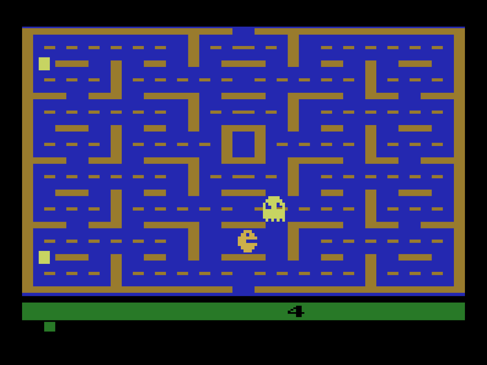
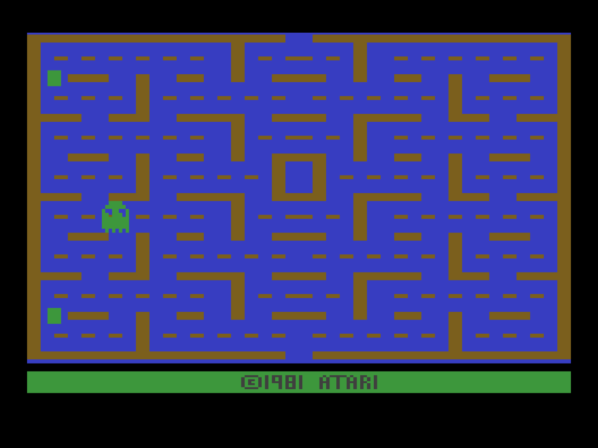
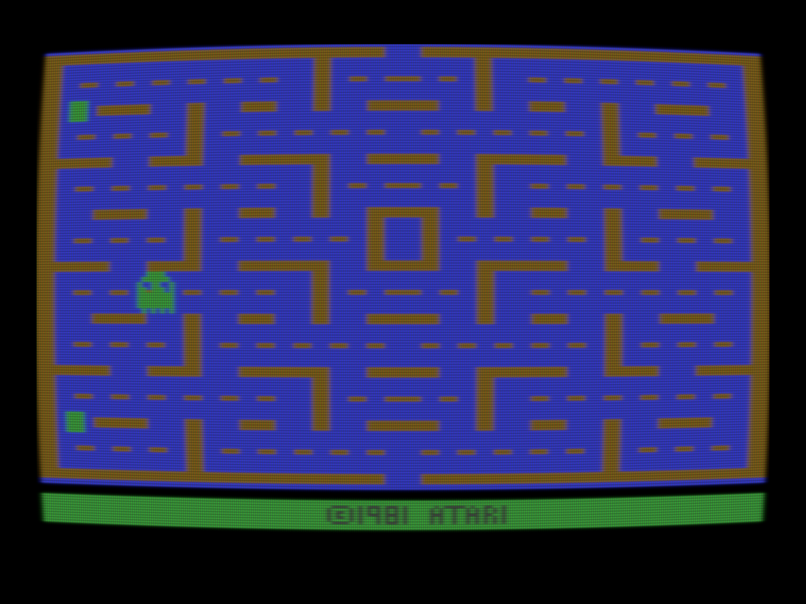
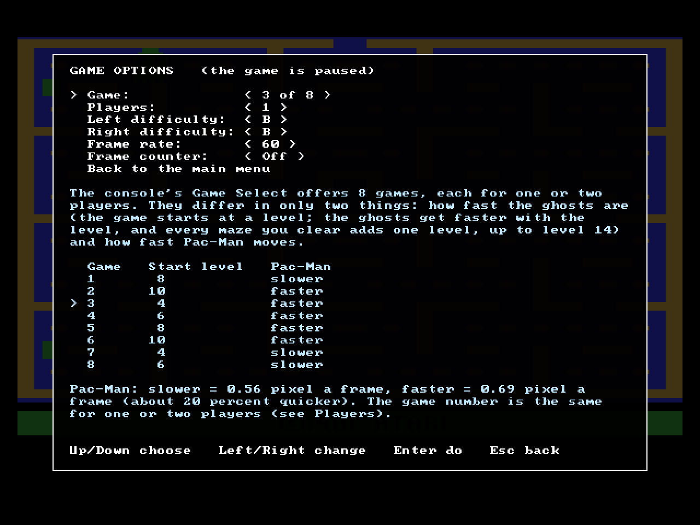
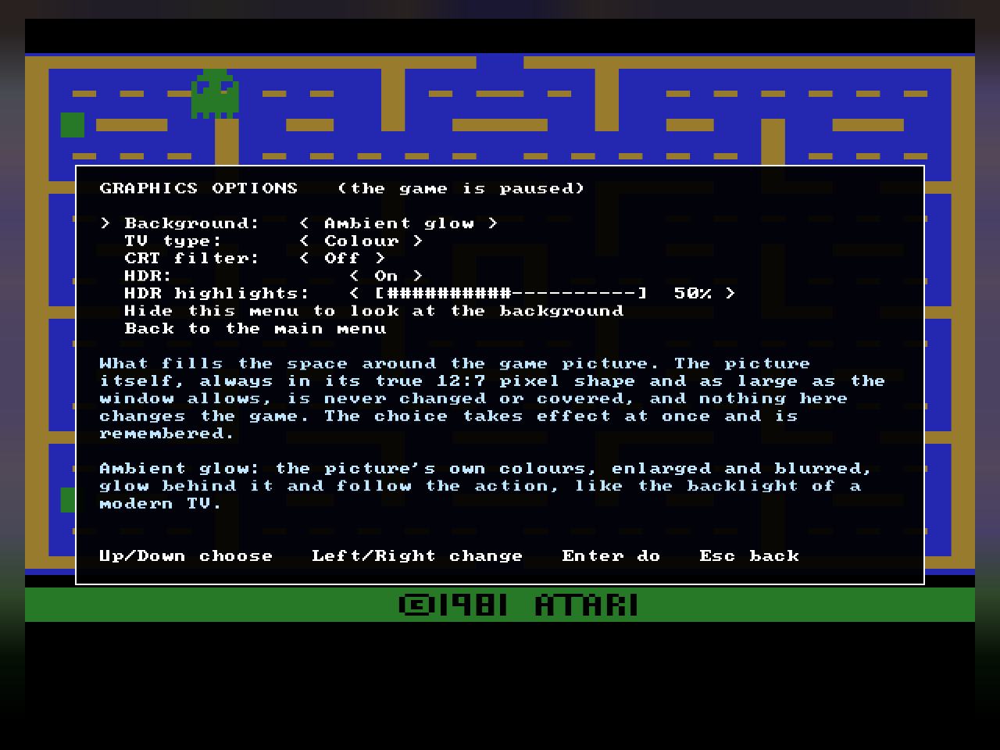

# Pac2600Comp

A Windows program that plays the Atari 2600 game *Pac-Man* (1981) with its own rebuilt game code, picture and sound.

> **You need your own copy of the game.** The game itself is **not included** and never will be. The program asks for your own legal copy of the cartridge file (a 4,096-byte file, usually called `Pac-Man (1981) (Atari).a26`) and checks its size and SHA-1 (`0940fea7f04cdb6d4b90c5ad1a7e344e68f6dbb1`) before it starts. Without the right file it does not run.
>
> **Pac2600Comp is an unofficial, fan-made program.** It is not made, endorsed or sponsored by any rights holder. PAC-MAN is a trademark of Bandai Namco Entertainment Inc. The Atari 2600 game "Pac-Man" (1981), its program, pictures and sounds belong to their respective rights holders (Atari and Bandai Namco). Atari and the Atari 2600 are trademarks of their owners. All other names are the property of their owners.

## What it is

The program plays the original game, not a copy-cat. The game's rules were written again in C++ and proved identical to the original, picture and sound, frame by frame: 70 recorded games (439,680 frames) and 120 games played with random input (2,400,000 frames) come out the same as the original game running in the Stella emulator. By default it behaves like a real 1981 NTSC console: 59.92 pictures a second, the picture in its true 12:7 pixel shape, the ghosts flickering as they did.

Everything beyond that is **optional and off by default**, and none of it changes what the game does:

- smoother motion at 75, 120, 144 pictures a second or unlocked (the original look is the default, 60);
- HDR highlights, CRT filters (CRT-Lottes, CRT-Geom, GDV NTSC 2600), and backgrounds around the picture;
- game pads (DualShock 4, DualSense, Xbox) with light bar and rumble;
- a menu, volume and mute, achievements and statistics, two players taking turns on one set of controls;
- recording a game and playing it back exactly.

How it works is in [docs/HOW_IT_WORKS.md](docs/HOW_IT_WORKS.md), how the game was preserved in [docs/PRESERVATION.md](docs/PRESERVATION.md). What changed in each version is in [CHANGELOG.md](CHANGELOG.md).

## Screenshots

The game in play, with the default look: the picture in its true 12:7 pixel shape, with a black border.

One of the CRT filters (CRT-Lottes, chosen in the menu under Graphics options), next to the same picture with the filter off:

| CRT filter off (the default) | CRT-Lottes |
|---|---|
|  |  |

The menu (Esc) pauses the game and explains every row. Its Game options page (game 1 to 8, players, difficulty switches, frame rate) and its Graphics options page (background, TV type, CRT filter, HDR):

The pictures are the program's own screenshots (made again with `tools\j41_screenshots.ps1`). The game's graphics shown in them belong to their rights holders, as the notice at the top says.

## Getting started

1. Unzip the release somewhere you can write to (your Documents or Desktop; not "Program Files").
2. Start `Pac2600Comp.exe`. The first time it asks for your game file. Or put the file into the `roms` folder next to the program first. It remembers where the file was and where you left the window.
3. Press **F3** (hold briefly), or the Options button on a PlayStation pad, to start a game.

Windows may warn you the first time ("unknown publisher"). That is expected: see [If Windows warns you](#if-windows-warns-you-and-checking-your-download) below.

## If Windows warns you, and checking your download

Pac2600Comp is a small free program and is **not signed** with a paid publisher certificate, so Windows may show a blue "Windows protected your PC" window ("unknown publisher") the first time you start `Pac2600Comp.exe` or one of the `.cmd` helpers. This is expected. Click **More info**, then **Run anyway**. To avoid it for every file, right-click the downloaded zip, choose **Properties**, tick **Unblock** if you see it, click **OK**, and only then unzip.

If you would rather check than trust:

- **Check the fingerprint.** Each release has a file ending in `.sha256` next to its zip (and the same number on the release page). In a Command Prompt run `certutil -hashfile Pac2600Comp-1.0.0-windows.zip SHA256` and compare the long number with the one in that file. If they differ, the download is not the genuine file.
- **Build it yourself** from the source (the release holds the source zip; see [BUILDING.md](BUILDING.md)).

Some antivirus programs distrust any new unsigned program; a fingerprint that matches and a build you made yourself are the answer to that.

## Controls

| Keyboard | Does |
|---|---|
| Arrow keys or W A S D | Joystick |
| Space or Z | Fire button (starts a game from the title screen) |
| F3 (hold) | Game Reset: start a new game |
| F2 (hold) | Game Select: next game variation |
| F4 | TV type: Colour / Black and white |
| F5 / F6 | Left / right difficulty switch A / B |
| F7 | Soft glow on / off (off = as on a real TV) |
| 1 2 3 4 5 | Picture: Sharp, Fill, TV frame, Game area, Framed (5 is the default) |
| Alt + Enter | Fullscreen on / off |
| F1 | Show or hide this list in the game |
| Esc | Open or close the menu (the game pauses while it is open) |

| PlayStation pad | Xbox pad | Does |
|---|---|---|
| D-pad / left stick | D-pad / left stick | Joystick |
| Cross or Square | A or X | Fire button |
| Options | Menu | Game Reset |
| Share | View | Game Select |
| L1 / R1 | LB / RB | Left / right difficulty |
| Triangle | Y | TV type |
| PS button or touchpad | Guide or right stick press | Open or close the menu |

The pad layouts are shown in the game too (F1, and the menu's Control options). A DualShock 4 was tried on real hardware; the DualSense and Xbox layouts are tested with virtual pads only.

## The menu (Esc)

Resume; New game; **Game options** (game 1 to 8, one or two players, the two difficulty switches, frame rate, frame counter); **Graphics options** (background, TV type, CRT filter, HDR); **Sound options** (volume, mute); **Control options** (which keys steer, rumble); **Achievements** (the 14 of the RetroAchievements set, worked out offline); **Statistics** (games, time, high score and more, kept between runs); Quit. Each row explains itself in the menu.

## Recording a game

`Record a game.cmd` plays as usual while every frame's input is recorded; close the game and the recording is in the `recordings` folder. `Replay a game.cmd` plays the newest recording back, or the file you drag onto it, and the game comes out exactly the same.

## Files the program writes

`settings.ini` next to the program: the path of your game file, window place and size, the switches, your choices from the menu, your achievements and your statistics. Delete it to start fresh. Nothing is sent anywhere: the program contains no network code.

## Building it yourself

See [BUILDING.md](BUILDING.md). Building needs no game file; playing and some of the tests do.

## Reporting a problem, and contributing

Found a bug? Open an issue and use the **bug report** form: it asks for the version (the name of the zip, or the first line of `BUILD-INFO.txt`), your Windows version and the fingerprint of your game file. **Never attach the game file.** A recording made with `Record a game.cmd` helps a lot.

Proposals are welcome as pull requests, and **nothing is merged without the owner's review and approval**. The rules (no game file, no change to what the game does by default, the tests must pass, the licence) are in [CONTRIBUTING.md](CONTRIBUTING.md).

## Licence and credits

Pac2600Comp's own code is licensed under the **GNU General Public License, version 2 or later**: see [LICENSE](LICENSE). It contains the colour table of the Stella emulator (GPL version 2 or later), ports of the CRT-Geom shader and most of the GDV NTSC shaders (GPL version 2 or later), CRT-Lottes (public domain), a few NTSC shader passes whose files state no licence, and uses SDL3 (zlib licence). Credits and the notices of each are in [THIRD_PARTY_NOTICES.md](THIRD_PARTY_NOTICES.md). The achievements are those of the RetroAchievements set for this game; the program does not connect to RetroAchievements.

The program comes **without any warranty**, to the extent the law allows.
